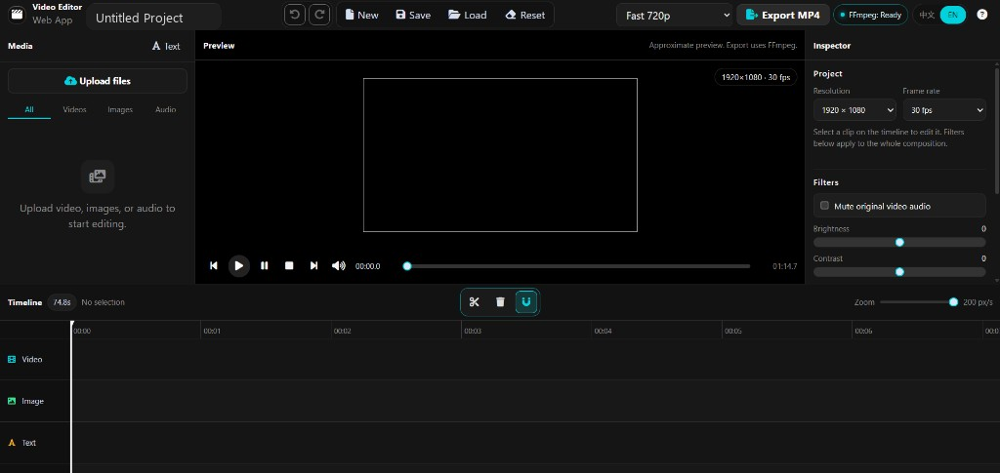

# Video Editor

A browser video editor. Upload media, arrange it on a timeline, preview the result, and export an MP4 with FFmpeg. No database and no user accounts.

## Quick start (XAMPP)

1. Copy this folder into your web root, for example `htdocs/Video_Editor`
2. Put `ffmpeg.exe` and `ffprobe.exe` in the project's `bin` folder (see FFmpeg below)
3. Start Apache in XAMPP. MySQL is not required
4. Open `http://localhost/Video_Editor/`
5. Wait until the status says **FFmpeg: Ready**
6. Choose **Upload files**, add a video, then **Add to Timeline**
7. Drag a clip to move it, drag its edges to trim, and press `S` to split at the playhead
8. Choose **Fast 720p** or **High Quality 1080p**, then **Export MP4**
9. When the job finishes, choose **Download MP4**

Use the **中文 / EN** switch in the top bar. The current project is kept in this browser.

## Features

- Upload video, images, and audio with progress and file checks
- Media library with categories, thumbnails, duration, and delete
- Video, image, text, and audio tracks
- Move, trim, split, delete, zoom, and snap
- Speed, volume, mute, crop, scale, position, and rotation
- Text and image overlays, including drag on the preview
- Brightness, contrast, saturation, grayscale, blur, and sepia
- Undo and redo (50 steps)
- Save and load in the browser, plus JSON import and download
- Fast 720p and high-quality 1080p export with progress
- On a phone, the preview and timeline stay in place while media and inspector open from the bottom
- A portable Windows app that runs without Apache

## Screenshot



## Folder structure

```text
Video_Editor/
├── index.php           Editor page
├── api/                Upload, media, preview, export, health
├── assets/css          Styles
├── assets/js           Timeline, preview, upload, export
├── includes/           Config, checks, FFmpeg, export jobs
├── bin/                Optional ffmpeg and ffprobe
├── uploads/            Uploaded media (not served directly)
├── exports/            Jobs and finished MP4 files
├── logs/               Server error log
├── desktop/            Windows app (C# / .NET 8)
└── docs/screenshots    Images used in this file
```

The built Windows app is `dist/VideoEditor/`. That folder is created by the build script and is not part of the source tree above.

## 1. XAMPP setup

1. Install [XAMPP](https://www.apachefriends.org/) and start **Apache**.
2. Place the project in the web root and open `http://localhost/Video_Editor/`. If the folder sits deeper in `htdocs`, add that path to the URL.
3. In `php.ini`, then restart Apache:

```ini
file_uploads = On
upload_max_filesize = 512M
post_max_size = 520M
max_execution_time = 300
max_input_time = 300
memory_limit = 512M
display_errors = Off
```

Use PHP 8.2 or newer with `fileinfo` and `json`. `mbstring` and `gd` are recommended. Export starts the PHP command line. On a default XAMPP install that binary is `C:\xampp\php\php.exe`. Set `PHP_CLI_PATH` in `includes/config.php` if PHP is installed somewhere else.

The web server must be able to write `uploads` (`videos`, `images`, `audio`, `meta`, `thumbs`), `exports/jobs`, `exports/output`, and `logs`.

## 2. Edit a project

1. Choose **Upload files**, or drop files on the media panel.
2. Choose **Add to Timeline**, or drag an item onto its track.
3. Drag a clip to move it. Drag either end to trim it.
4. Select a video and press `S` to split it at the playhead.
5. Use the inspector for speed, volume, crop, text, and position.
6. Drag images and text on the preview. Use the corner handle to resize an image.

| Kind | Default limit | Extensions |
| --- | --- | --- |
| Video | 512 MB | mp4, webm, mov, wmv |
| Image | 25 MB | jpg, jpeg, png, webp |
| Audio | 80 MB | mp3, wav, aac, m4a |

If the browser cannot play a file, FFmpeg makes a preview MP4 when it is available. Export still uses the original file.

Shortcuts: Space play/pause, Home / End jump, Delete remove, Ctrl+Z / Ctrl+Y undo and redo, Ctrl+S save a browser snapshot.

The default frame is 1920×1080 at 30 fps. A new project is named Untitled Project.

## 3. Export an MP4

1. Put at least one video, image, or text item on the timeline. Audio alone cannot be exported.
2. Choose **Fast 720p** or **High Quality 1080p**.
3. Choose **Export MP4** and wait for the job to finish.
4. Choose **Download MP4**.

Fast export is 1280×720, H.264 `veryfast`, CRF 26, AAC 128k. High quality is 1920×1080, H.264 `medium`, CRF 18, AAC 192k. A portrait frame is fitted inside that size with black bars. One export can be up to 20 minutes.

The page sends the project to `api/export.php`. PHP runs `api/export_worker.php` and the page polls `api/export_status.php`.

## 4. FFmpeg

The app looks for the tools in this order:

1. `FFMPEG_PATH` and `FFPROBE_PATH` in `includes/config.php`
2. `bin/ffmpeg.exe` and `bin/ffprobe.exe` on Windows, or `bin/ffmpeg` and `bin/ffprobe` on other systems
3. The system `PATH`

On Windows, copy both programs from an [FFmpeg essentials build](https://www.gyan.dev/ffmpeg/builds/) into `bin`, or install them with:

```text
winget install Gyan.FFmpeg
```

On Linux, `sudo apt install ffmpeg`. On macOS, `brew install ffmpeg`. Use version 4.4 or newer with `libx264` and `aac`.

The status is ready only when both tools run and the upload and export folders are writable. Video and audio upload need FFprobe. Export needs FFmpeg.

## 5. Portable Windows app

Open:

`dist/VideoEditor/VideoEditor.exe`

Copy the whole `dist/VideoEditor` folder. FFmpeg and the .NET runtime sit beside the program. The program also needs the Microsoft Edge WebView2 runtime, which is usually already present when Edge is installed. Uploads and exports are stored in that folder's `data` directory.

Rebuild from `desktop/VideoEditor.Win`:

```text
powershell -ExecutionPolicy Bypass -File desktop\build-portable.ps1
```

## 6. Shared hosting

Build a small archive from the project folder:

```text
python desktop/build-cpanel-zip.py
```

The archive is created next to the project and contains one `Video_Editor` folder. It does not include Windows `ffmpeg.exe` files.

1. Remove any older copy of that folder on the host.
2. Upload the archive and extract it in the site directory.
3. Use PHP 8.2 or newer, and allow `proc_open`.
4. Raise the upload limits in the host's PHP settings to match the local `php.ini` values.
5. Make `uploads`, `exports`, and `logs` writable by PHP.
6. If FFmpeg is installed on the host, set its absolute paths in `includes/config.php`. Without FFmpeg the page still opens, but export will not run.

Opening `assets/css/editor.css` in the browser should show the stylesheet. If the page is unstyled, extract again so `assets` stays next to `index.php`.

## 7. Troubleshooting

| What you see | What to do |
| --- | --- |
| FFmpeg: Not Available | Install FFmpeg and FFprobe, or set their paths in `includes/config.php`, then restart Apache |
| Unsupported file type | Use an extension from the table above. Renaming the file is not enough |
| File is too large | Raise both the PHP limits and the limits in `includes/config.php` |
| Upload failed, or the folder is not writable | Turn on `file_uploads` and make `uploads`, `exports`, and `logs` writable |
| Media could not be analysed | The file is damaged, or it is not a real video or audio file |
| Missing media | A timeline item still points at a deleted file. Remove that clip |
| Export could not be started | Set `PHP_CLI_PATH`, and make sure `proc_open` is allowed |
| Export failed | Read `logs/app.log` and the job log under `exports/jobs` on the server. The page does not show server paths |
| A required font is missing | Windows uses `C:\Windows\Fonts`. Linux needs DejaVu or Liberation fonts |
| Blank page or HTTP 500 | Allow `.htaccess` in the web root and check the Apache error log |

`api/health.php` reports whether the tools are available. It does not return file paths.

## How a project moves through the app

1. Open the editor and confirm FFmpeg is ready
2. Upload media and place it on the timeline
3. Trim, split, and add text or music
4. The browser sends the project as JSON
5. PHP checks it and runs FFmpeg
6. The page shows progress, then offers the MP4 download

## Security

- Stored file names are random ids. The original name is display text only
- Extension, MIME type, and file contents are checked. Scripts and unknown types are rejected
- Resolved paths must stay inside `uploads` or `exports`
- FFmpeg arguments are passed as a list, not joined into a shell command
- API errors stay short. Paths and command lines are written only to server logs
- `.htaccess` blocks direct access to `includes`, `uploads`, `exports`, `logs`, and `bin`. Media is read through `api/stream.php`
- This version has no login. Add your own access control before putting it on the public internet, and keep the upload limits conservative

Leave the tool paths in `includes/config.php` empty to use automatic detection.

## License

This project is licensed under the [MIT License](LICENSE).
